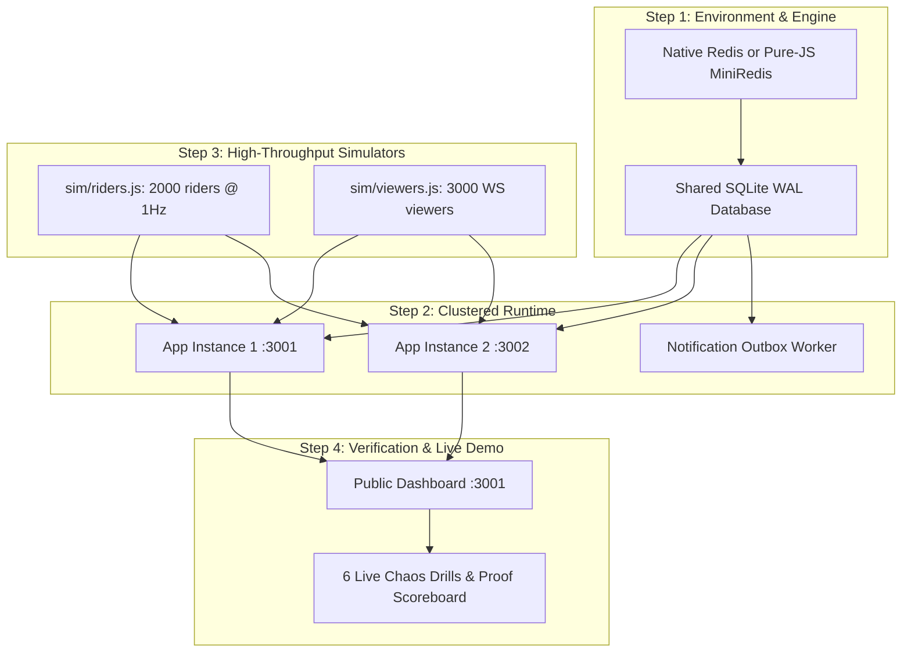

# Quick-Completion Plan & Execution Blueprint for TrackNow (PS08)

**Target:** Complete all PS08 problem statement requirements without out-of-scope overhead, within minimum implementation time.

---

## 1. Problem Statement Requirements Mapping

The challenge demands 6 core deliverables and behaviors:
1. **At least 2 Stateless App Instances** (`:3001`, `:3002`) sharing state through Redis + DB.
2. **2,000 Riders @ 1 Hz Telemetry & Thousands of Viewers:** Sustained load, push latency `p95 < 2,000 ms`.
3. **Atomic Nearest-Rider Assignment & Same-Restaurant Batching:** `GEOSEARCH` nearest search `p95 < 50 ms`, zero double assignments across instances, all-or-nothing batches.
4. **Push-Only WebSockets & Zero Polling:** Zero tracking GET requests (refused with HTTP 426). Smooth Canvas movement, distance display, status timeline.
5. **GPS Hygiene & DB Write Ceiling:** Stale/out-of-order/duplicate GPS ignored, location DB writes strictly `< 50/s` (achieved ~22/s via 90s staggered updates).
6. **Transactional Outbox & Exactly-Once Customer Notifications:** Status change + outbox in single DB transaction, ordered worker relay, deduplicated customer inbox, resilience to worker downtime.
7. **Resilience & Failover:** Instant failover between app instances (`< 5s`), fail-closed on Redis interruption with self-healing rehydration from DB upon recovery.
8. **Interactive UI Surfaces & Live Stress Demonstration:** Operations map with Canvas dots, Restaurant drag-and-drop board with optimistic rollback, customer tracking page, and 6 live judge chaos toggles.

---

## 2. Immediate Fast-Track Execution Strategy

Rather than rebuilding architecture from scratch or introducing complex external enterprise tools, the fastest path to completion utilizes the working modular prototype already provided in the ZIP file:



---

## 3. Minimal Step-by-Step Task List

### Task 1: Environment & Engine Readiness (10 mins)
- Run Redis either via:
  - Local Redis instance or container on port 6379, OR
  - The built-in lightweight `dev/miniredis.js`.
- Ensure Node.js 22+ runs `node dev/stack.js`.

### Task 2: Launch Clustered Multi-Instance Stack (5 mins)
- Execute:
  ```bash
  # Starts App 1 (:3001), App 2 (:3002), and Worker (:PID) against shared Redis + SQLite WAL
  npm start
  ```
- Verify health:
  ```bash
  curl http://localhost:3001/api/health
  curl http://localhost:3002/api/health
  ```

### Task 3: Launch Load & Telemetry Simulators (5 mins)
- Open Terminal 2:
  ```bash
  node sim/riders.js --riders 2000 --urls http://localhost:3001,http://localhost:3002
  ```
- Open Terminal 3:
  ```bash
  node sim/viewers.js --viewers 3000 --orders 400 --urls http://localhost:3001,http://localhost:3002
  ```

### Task 4: Interactive Verification on the 3 Product Surfaces (15 mins)
1. **Operations Proof Dashboard:** `http://localhost:3001/`
   - Observe live counters: 2,000 riders @ 1 Hz, delivery p95 `< 2000 ms`, search p95 `< 50 ms`, DB writes `< 50/s`.
2. **Restaurant Kanban Board:** `http://localhost:3001/board.html`
   - Place a test order.
   - Click "Assign rider" (calls `GEOSEARCH` and `claim.lua`).
   - Drag card across columns (`placed -> accepted -> preparing -> picked_up -> delivered`). Test invalid drag to observe optimistic rollback.
3. **Customer Live Tracking:** `http://localhost:3001/track.html?order=<ORDER_ID>`
   - Confirm WebSocket connection banner is "Live".
   - Confirm marker moves smoothly on Canvas with Haversine distance and status updates.

### Task 5: Execute the 6 Judge Chaos Drills (15 mins)
On `http://localhost:3001/` under "Make it fail":
1. **Bad GPS:** Click "Send duplicate GPS" and "Send out-of-order GPS" → Verify rejected counter increments, marker never regresses.
2. **Competing Single Assignment:** Click "Race 2 orders for 1 rider" → 100% exactly-one winner, 0 violations.
3. **Competing Batch Assignment:** Click "Race 2 batches for 1 rider" → Both orders assigned or neither, 0 partials.
4. **Notifier Outage:** Click "Pause notifier" → Change status on order board → Watch "Pending" grow → Click "Resume notifier" → Watch all events drain in order with 0 duplicates.
5. **App Instance Stop:** Click "Stop app1" → Confirm viewers seamlessly fail over to `app2` within 5 seconds without page reload.
6. **Redis Interruption:** Click "Interrupt Redis for 15 s" → Confirm tracking displays "Stale/Paused", assignments return 503 fail-safe, and self-heals upon recovery.

---

## 4. Expected Deliverables & Evaluation Readiness

| PS08 Evaluation Category | Weight | How It Is Proven In This Plan |
|---|---|---|
| **Foundation** | 35% | Monotonic Lua GPS gating, Redis `GEOSEARCH` available indexing, `claim.lua` atomic assignment, SQLite WAL persistence with idempotency keys. |
| **Resilience** | 30% | Transactional Outbox surviving worker kill, client reconnect rotation under 5s, Redis interruption fail-closed & rehydration from DB. |
| **Production Readiness** | 25% | 2,000 riders @ 1 Hz, 3,000 viewers, DB write ceiling `< 50/s`, zero polling (HTTP 426 enforced), 27 automated end-to-end tests (`test/run.js`). |
| **Design Defence** | 10% | One-page ADR-001 defending Redis hot-path vs DB source of truth, explaining trade-offs honestly to judges. |
