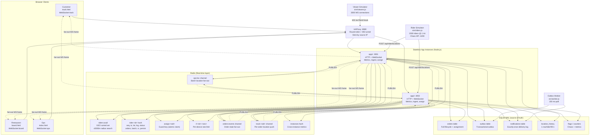
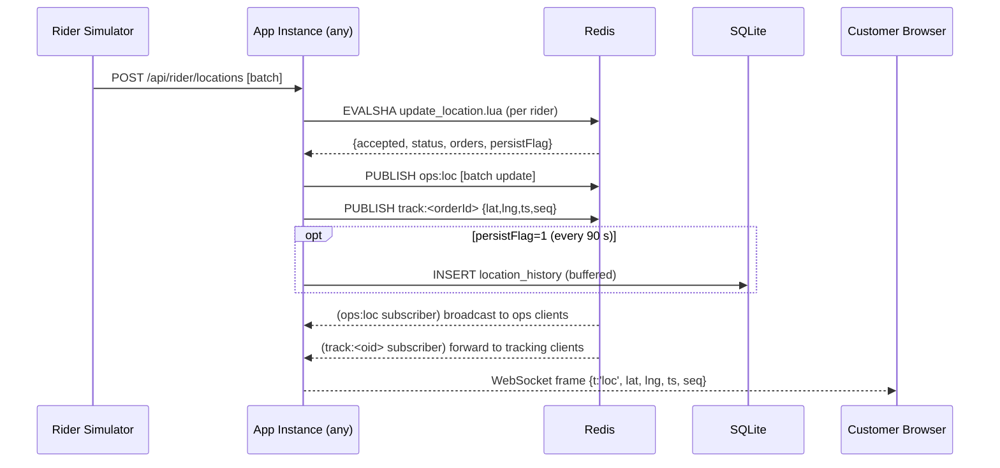
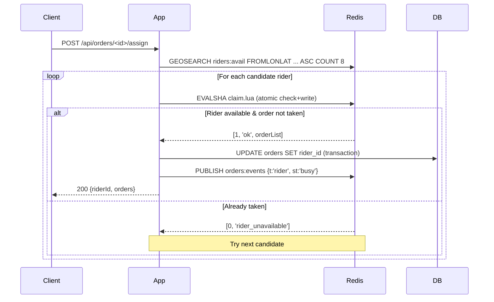

# TrackNow — Architecture

## System Flow

## Key Design Decisions

| Concern | Solution |
|---------|----------|
| Location scale | GPS batched in chunks of 250, ingested via `update_location.lua` atomically |
| Zero double-assignment | `claim.lua` Lua script: check + write in one atomic MULTI-exec |
| Atomic batch | Same Lua script claims both orders or neither |
| Stale GPS rejection | Monotonic `seq` + `ts` checked inside Lua |
| Rate limiting | Fixed-window per-device via `rl:<id>:<sec>` INCR + PEXPIRE |
| Fan-out routing | Per-order Redis channel `track:<orderId>` → only the right viewers |
| Exactly-once notifications | Transactional Outbox in SQLite; `PRIMARY KEY (order_id, version)` prevents duplicates |
| DB write throttle | Persist flag in Redis hash; 1 row per rider per 90 s = ≈22 writes/s for 2000 riders |
| Redis failure | Fail-closed on assignment, fail-open on rate-limit; `rebuild()` restores state from DB on recovery |
| Instance failover | Client rotates to next endpoint in `eps[]` on WebSocket close; reconnect p95 < 5 s |
| Ops map efficiency | Only dirty riders sent per second; client-side Canvas renders 2000 dots at 60 fps |

## Data Path: Location Update

## Data Path: Rider Assignment

